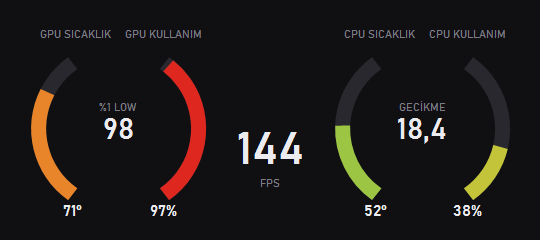

# Game Monitor (Oyun Monitörü)

[English](#english) · [Türkçe](#türkçe)


## English

A tiny, always-on-top overlay window for Windows that shows, while you play:

- **GPU** temperature and usage (NVIDIA)
- **CPU** temperature (Intel) and usage
- **FPS**, **1% low** and **latency** of the game in the foreground

It is a single C# file, built with the C# compiler that ships with Windows. It is designed to stay out of the way: values are measured 4 times per second and smoothed, and the window is only redrawn when a visible value changes. Idle usage measured on the author's machine: about 0.03% CPU and ~50 MB RAM for the app, plus ~0.03% CPU and ~7 MB for PresentMon.

The interface language follows Windows: Turkish if the Windows display language is Turkish, English otherwise.

### Requirements

| Item | Needed for | Notes |
|---|---|---|
| Windows 10 or 11, 64-bit | everything | |
| .NET Framework 4.8 | everything | Built into Windows 10 (1903+) and Windows 11 |
| NVIDIA GPU + driver | GPU temperature/usage | Read from the driver's `nvml.dll`. AMD/Intel GPUs show `—` |
| Intel CPU + [PawnIO](https://pawnio.eu/) driver | CPU temperature | Separate install (see below). AMD CPUs show `—` |
| `bin\PresentMon.exe` | FPS, 1% low, latency | Included in the release zip |
| Administrator rights | FPS, CPU temperature | See below |

**Why administrator rights?** FPS and latency come from Intel PresentMon, which reads the Windows ETW (Event Tracing for Windows) graphics events. Starting an ETW trace session requires administrator rights; without them PresentMon fails with "access denied". The PawnIO driver also only accepts administrators. That is why the app asks for permission (UAC prompt) every time it starts. It does not try to bypass UAC.

### Install (release zip)

1. Download `OyunMonitor-vX.Y.Z-win-x64.zip` from the [Releases](../../releases) page and extract it to any folder (keep the `bin` folder next to `OyunMonitor.exe`).
2. *(Optional, Intel CPUs only)* Install the PawnIO driver for CPU temperature: <https://pawnio.eu/> or [PawnIO.Setup releases](https://github.com/namazso/PawnIO.Setup/releases). Without it the CPU temperature shows `—`; everything else works.
3. Run `OyunMonitor.exe` and accept the UAC prompt.

Usage: drag the window with the left mouse button. Right-click for "Always on top" and "Close". The game being measured is the window in the foreground. The window position is saved to `%APPDATA%\OyunMonitor\konum.txt`.

Windows SmartScreen may warn because the exe is not code-signed. You can build it yourself from source instead (below).

### Build from source

No SDK or Visual Studio needed; the .NET Framework 4.8 compiler (`csc.exe`) that comes with Windows is used.

```bat
git clone https://github.com/samisnmez/oyun-monitor.git
cd oyun-monitor
build.cmd
```

This produces `OyunMonitor.exe`. Then create a `bin` folder next to it and add the external tools:

- `bin\PresentMon.exe`: download `PresentMon-2.6.0-x64.exe` from [PresentMon releases](https://github.com/GameTechDev/PresentMon/releases/tag/v2.6.0) and rename it to `PresentMon.exe`.
- `bin\IntelMSR.bin` (Intel CPU temperature): take `IntelMSR.bin` from `release_0_2_11.zip` in [PawnIO.Modules releases](https://github.com/namazso/PawnIO.Modules/releases/tag/0.2.11).

Design check without starting the monitor: `OyunMonitor.exe --preview out.png [en|tr]` saves an image of the window with sample values. (If built without `/win32manifest:app.manifest` it runs without the UAC prompt.)

### Limitations

- GPU values: NVIDIA only, first GPU only.
- CPU temperature: Intel only (package temperature via MSR), and only with the PawnIO driver installed.
- FPS/latency are measured for the foreground window's process. Clicking the monitor keeps the last game.
- Latency source, in order of preference: NVIDIA Reflex PC latency, input-to-photon latency, render latency (estimate).
- 1% low = 1000 / 99th percentile of frame times over the last 30 seconds; it may differ from other tools.
- Tested on Windows 11 with an NVIDIA GPU and an Intel CPU only. Behavior on AMD/NVIDIA-less systems is handled in code (values show `—`) but has not been tested on real hardware.

### License

MIT, see [LICENSE](LICENSE). Third-party tools in the release zip (`bin\`) have their own licenses: PresentMon (MIT, Intel) and PawnIO.Modules IntelMSR (LGPL-2.1-or-later, namazso). See [third_party/](third_party/THIRD-PARTY-NOTICES.txt).

---

## Türkçe



Oyun oynarken her zaman üstte duran küçük bir Windows penceresi. Gösterdikleri:

- **GPU** sıcaklığı ve kullanımı (NVIDIA)
- **CPU** sıcaklığı (Intel) ve kullanımı
- Ön plandaki oyunun **FPS**, **%1 low** ve **gecikme** değerleri

Tek bir C# dosyasıdır ve Windows'la gelen C# derleyicisiyle derlenir. Az kaynak tüketecek şekilde tasarlandı: değerler saniyede 4 kez ölçülüp yumuşatılır, pencere yalnız görünen bir değer değişince yeniden çizilir. Yazarın makinesinde boşta ölçülen tüketim: uygulama için yaklaşık %0,03 CPU ve ~50 MB RAM, PresentMon için ~%0,03 CPU ve ~7 MB.

Arayüz dili Windows'a göre seçilir: Windows görüntüleme dili Türkçe ise Türkçe, değilse İngilizce.

### Gereksinimler

| Gereken | Ne için | Not |
|---|---|---|
| Windows 10 veya 11, 64 bit | hepsi | |
| .NET Framework 4.8 | hepsi | Windows 10 (1903+) ve Windows 11'de hazır gelir |
| NVIDIA ekran kartı + sürücü | GPU sıcaklık/kullanım | Sürücünün `nvml.dll`'inden okunur. AMD/Intel ekran kartında `—` görünür |
| Intel işlemci + [PawnIO](https://pawnio.eu/) sürücüsü | CPU sıcaklığı | Ayrı kurulur (aşağıda). AMD işlemcide `—` görünür |
| `bin\PresentMon.exe` | FPS, %1 low, gecikme | Release zip'inde var |
| Yönetici izni | FPS, CPU sıcaklığı | Aşağıya bakın |

**Neden yönetici izni?** FPS ve gecikme, Windows'un ETW (Event Tracing for Windows) grafik olaylarını okuyan Intel PresentMon'dan gelir. ETW izleme oturumu başlatmak yönetici izni ister; izin yoksa PresentMon "access denied" hatası verir. PawnIO sürücüsü de yalnız yöneticiye açıktır. Bu yüzden uygulama her açılışta izin sorar (UAC penceresi). UAC'yi atlatmaya çalışmaz.

### Kurulum (release zip)

1. [Releases](../../releases) sayfasından `OyunMonitor-vX.Y.Z-win-x64.zip` dosyasını indirip istediğiniz klasöre çıkarın (`bin` klasörü `OyunMonitor.exe`'nin yanında kalmalı).
2. *(İsteğe bağlı, yalnız Intel işlemci)* CPU sıcaklığı için PawnIO sürücüsünü kurun: <https://pawnio.eu/> ya da [PawnIO.Setup sürümleri](https://github.com/namazso/PawnIO.Setup/releases). Kurulmazsa CPU sıcaklığı `—` görünür, gerisi çalışır.
3. `OyunMonitor.exe`'yi çalıştırıp UAC iznini verin.

Kullanım: pencereyi farenin sol tuşuyla sürükleyin. Sağ tıkla "Her zaman üstte" ve "Kapat". Ölçülen oyun, ön plandaki penceredir. Pencere konumu `%APPDATA%\OyunMonitor\konum.txt` dosyasına kaydedilir.

Exe kod imzalı olmadığı için Windows SmartScreen uyarı verebilir. İsterseniz kaynaktan kendiniz derleyebilirsiniz (aşağıda).

### Kaynaktan derleme

SDK ya da Visual Studio gerekmez; Windows'la gelen .NET Framework 4.8 derleyicisi (`csc.exe`) kullanılır.

```bat
git clone https://github.com/samisnmez/oyun-monitor.git
cd oyun-monitor
build.cmd
```

`OyunMonitor.exe` oluşur. Yanına bir `bin` klasörü açıp dış araçları ekleyin:

- `bin\PresentMon.exe`: [PresentMon sürümlerinden](https://github.com/GameTechDev/PresentMon/releases/tag/v2.6.0) `PresentMon-2.6.0-x64.exe`'yi indirip adını `PresentMon.exe` yapın.
- `bin\IntelMSR.bin` (Intel CPU sıcaklığı): [PawnIO.Modules sürümlerindeki](https://github.com/namazso/PawnIO.Modules/releases/tag/0.2.11) `release_0_2_11.zip` içinden `IntelMSR.bin`.

Monitörü başlatmadan tasarım kontrolü: `OyunMonitor.exe --onizleme cikti.png [tr|en]` örnek değerlerle pencere resmini kaydeder. (`/win32manifest:app.manifest` olmadan derlenirse UAC sormadan çalışır.)

### Sınırlamalar

- GPU değerleri: yalnız NVIDIA, yalnız ilk ekran kartı.
- CPU sıcaklığı: yalnız Intel (MSR üzerinden paket sıcaklığı) ve yalnız PawnIO sürücüsü kuruluysa.
- FPS/gecikme ön plandaki pencerenin süreci için ölçülür. Monitörün kendisine tıklanınca son oyun korunur.
- Gecikme kaynağı, öncelik sırasıyla: NVIDIA Reflex PC gecikmesi, girişten ekrana gecikme, render gecikmesi (tahmin).
- %1 low = son 30 saniyedeki kare sürelerinin 99. yüzdeliğinden 1000 / p99; başka araçlardan farklı çıkabilir.
- Yalnız Windows 11, NVIDIA ekran kartı ve Intel işlemcide denendi. AMD/NVIDIA'sız sistemlerdeki davranış kodda ele alındı (değerler `—` görünür) ama gerçek donanımda denenmedi.

### Lisans

MIT, bkz. [LICENSE](LICENSE). Release zip'indeki üçüncü taraf araçların (`bin\`) kendi lisansları vardır: PresentMon (MIT, Intel) ve PawnIO.Modules IntelMSR (LGPL-2.1-or-later, namazso). Bkz. [third_party/](third_party/THIRD-PARTY-NOTICES.txt).
